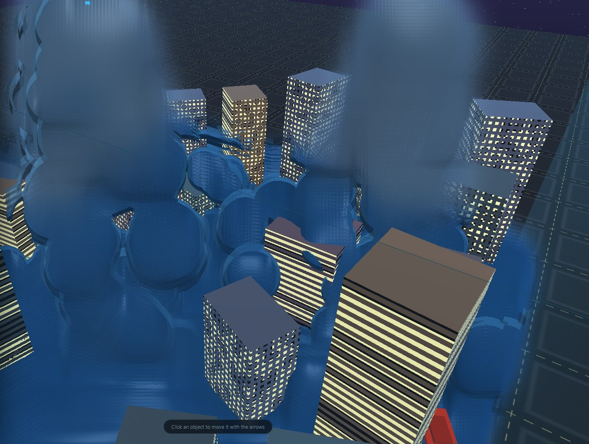

# FluidLab 3D

Real-time 3D fluid simulation in the browser. Pure **WebGL2** — no libraries, no build step, no CDN. Runs straight from `file://` and from GitHub Pages.

**Live demo:** https://kotjleta.github.io/fluidlab-3d/

**Русская версия:** [README.ru.md](README.ru.md)



---

## What it is

A **Position Based Fluids (PBF)** solver runs entirely on the GPU: five fragment passes per frame (predict → density/λ → Δp → velocity), positions and velocities kept in MRT `RGBA32F` targets, neighbour search done by a counting sort on the CPU and uploaded as a grid texture. 131 072 particles can be allocated; 24 576 are active by default.

The liquid is drawn as a screen-space surface: particles write depth and thickness into floating-point targets, depth is dilated and bilaterally blurred, thickness is blurred separately, and the composite adds Fresnel, refraction, Beer–Lambert absorption and a soft specular sheen. The result reads as one continuous, formless mass rather than a pile of spheres.

Besides liquids there is a second category — **granular particles** (snow, sand, dust). They are not part of the PBF solver: they fall under their own gravity and drag, carry no pressure, and are drawn as individual flakes and grains instead of a fluid surface.

## Features

- **Liquids:** water, oil, lava, slime — each with its own spacing, viscosity and buoyancy.
- **Granular:** snow, sand, dust — ballistic particles with per-type gravity and drag.
- **Levels:** Mini city, Mid city, Giant city, Snow globe, Volcano island, Open ground, Portal lab.
- **Tile-based cities:** every city is a grid of blocks; one building per block, roads between. Building, car and particle sizes are identical on all three city levels — only the number of buildings changes (about 90 / 540 / 2350). Buildings are drawn in a single merged draw call.
- **Scenarios per level:** Flood / Sewer burst / Tsunami / Downpour / Mixed fluids (cities), Snowfall (snow globe), Eruption / Lava flow (volcano), River / Downpour / Mixed (open ground), Portal loop (portal lab). One source by default; only scenarios that need many (tsunami waves, sewer burst) create several.
- **Modes:** Navigate (hand) and Edit (cursor); navigation is the default.
- **Sky presets:** grid, night, sunset, day, nebula, studio, Christmas night.
- **Obstacles:** buildings with lit windows, cars, trees, snowmen, wooden houses, a volcano cone — all with collision.
- **Sources and objects** can be added, moved and edited; each object has an inspector.
- **Two languages:** English and Russian, chosen from the system locale on first launch, switchable at any time with the EN / RU toggle in the panel header.
- **State persists** in `localStorage`.

## Controls

| Input | Action |
| --- | --- |
| Drag LMB | Orbit the camera |
| WASD | Fly |
| Space / Shift | Up / down |
| Q / E | Up / down (alternative) |
| Wheel | Zoom |
| Drag RMB | Push the fluid |
| Click (Edit mode) | Select an object |
| Arrows (Edit mode) | Move the selected object |

## Run locally

```bash
python -m http.server 8080
# open http://localhost:8080
```

On Windows, `start.bat` opens the file directly and `serve.bat` starts a local server. Opening `index.html` from disk works too — there are no ES modules and no `fetch` calls.

## Project layout

```
index.html        markup and panels
css/style.css     UI styling
js/math.js        mat4 / vec3 helpers
js/gl.js          thin WebGL2 wrappers
js/shaders.js     all GLSL
js/sim.js         PBF solver, grid, emitters
js/render.js      render targets and passes
js/world.js       types, levels, scenarios, props
js/i18n.js        EN/RU dictionaries
js/ui.js          panel building and tooltips
js/gizmo.js       object manipulation gizmo
js/store.js       localStorage persistence
js/main.js        app loop, camera, input
```

## Requirements

A browser with WebGL2 and `EXT_color_buffer_float` — every current desktop browser and most mobile ones. Without it the app shows a clear error message instead of a blank canvas.

## License

MIT.
