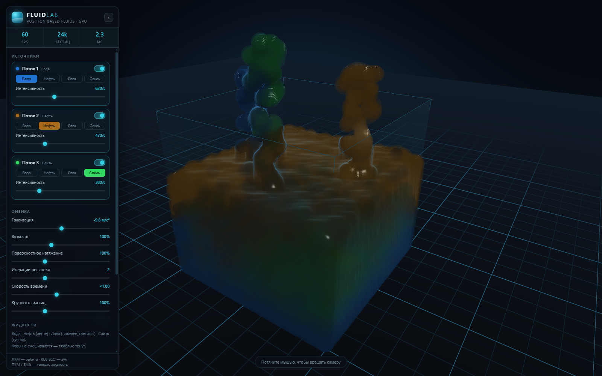

# FluidLab 3D

Симуляция жидкости в реальном времени в 3D на **WebGL2** без внешних зависимостей.
Физика — **Position Based Fluids (PBF)** на GPU, рендер — экранно-пространственная
реконструкция поверхности (Screen Space Fluid Rendering).



---

## Запуск

Никакой сборки и установки не требуется.

**Способ 1 — просто открыть файл**

Двойной клик по `index.html` (Chrome, Edge, Firefox, Opera последних версий).
Приложение написано на классических `<script>`, поэтому работает прямо с `file://`.

**Способ 2 — локальный сервер** (если браузер ограничивает `file://`)

```bash
cd fluidlab-3d
python -m http.server 8000
```

Затем открыть <http://localhost:8000>.

**Требования:** браузер с WebGL2 и поддержкой `EXT_color_buffer_float`
(есть на любом GPU последних ~10 лет, включая встроенную графику Intel/AMD).
Если расширение недоступно, приложение покажет понятное сообщение.

---

## Управление

| Действие | Что делает |
|---|---|
| **ЛКМ + перетаскивание** | Вращение камеры (орбита) |
| **Колесо мыши** | Приближение / отдаление |
| **ПКМ + перетаскивание** (или **Shift + ЛКМ**) | Толкать жидкость курсором |
| **‹** в шапке панели | Свернуть панель |

### Источники (3 шт.)

У каждого источника:

* **Вкл/выкл** — тумблер справа в карточке;
* **Тип жидкости** — Вода / Нефть / Лава / Слизь (кнопки-чипы);
* **Интенсивность** — сколько частиц в секунду выбрасывается (40…1400).

### Физика

| Параметр | Диапазон | Смысл |
|---|---|---|
| Гравитация | −22…+2 м/с² | Отрицательная — вниз; можно «перевернуть» мир |
| Вязкость | 0…250 % | XSPH-вязкость: вода → мёд |
| Поверхностное натяжение | 0…300 % | Искусственное давление `s_corr` (не даёт частицам слипаться в комки) |
| Итерации решателя | 1…4 | Больше — жёстче несжимаемость, дороже по времени |
| Скорость времени | ×0.15…×2 | Масштаб шага симуляции |
| Крупность частиц | 60…180 % | Визуальный радиус сфер при рендере |

### Сцена

* **+ Сфера**, **+ Куб** — добавить препятствие в случайное место;
* **Убрать препятствия** — очистить сцену;
* **Сброс** — заново залить резервуар и перезапустить источники;
* **Пауза** — остановить симуляцию (рендер и камера продолжают работать);
* **Авто-вращение** — медленно облетать сцену;
* **Водоворот** — включить тангенциальную силу, закручивающую всю жидкость.

---

## Типы жидкостей

| Тип | Цвет | Плотность (шаг решётки) | Вязкость | Плавучесть |
|---|---|---|---|---|
| Вода | синий | 0.055 | 0.10 | нейтральная |
| Нефть | янтарный | 0.063 (легче) | 0.30 | всплывает |
| Лава | оранжевый, светится | 0.051 (тяжелее) | 0.55 | тонет |
| Слизь | зелёный | 0.058 | 0.85 | нейтральная |

Каждый тип имеет собственную целевую плотность в решателе, поэтому фазы
естественно расслаиваются: нефть собирается сверху, лава опускается на дно.
В рендере цвет и толщина смешиваются взвешенно, а «горячие» жидкости
(высокая красная компонента) получают самосвечение.

---

## Как это устроено

### Физика: PBF на GPU

Каждый кадр выполняется цепочка фрагментных шейдеров над текстурами `RGBA32F`
(по одной текстуре на атрибут, разрешение `128 × N/128`, частица = тексель):

1. **Predict** — `v += g·dt`, `x* = x + v·dt`, ограничение скорости, силы мыши/вихря.
2. **Density / λ** — для каждой частицы считается плотность
   `ρ_i = Σ_j W(r_ij)` (ядро Poly6) и множитель Лагранжа
   `λ_i = −C_i / (Σ|∇W|²/n₀² + ε)`, где `C_i = ρ_i/n₀ − 1`.
3. **Δp** — `Δp_i = 1/n₀ Σ_j (λ_i + λ_j + s_corr) ∇W_ij` (градиент Spiky),
   плюс выталкивание из препятствий и стенок. Шаги 2–3 повторяются
   `iterations` раз (метод Якоби).
4. **Velocity** — `v = (x* − x)/dt`, сглаживание XSPH, отскок от препятствий,
   запись новых позиций и скоростей через **MRT** (два color attachment).

Поиск соседей: **равномерная сетка** (шаг = радиус сглаживания `h`).
Сетка строится на CPU — counting sort по ячейкам, ~0.3 мс на 24k частиц, —
и загружается на GPU двумя текстурами (`start/count` и отсортированные индексы).
Шейдер обходит 27 соседних ячеек.

Стабилизация: клампинг отрицательной части `C` (иначе свободная поверхность
«всасывает» частицы и решатель взрывается), клампинг `|λ|` и максимального
смещения за итерацию.

Источники и рециклинг — на CPU: частицы, ушедшие за границы домена,
«паркуются» и переиспользуются; чтобы поток не иссякал, самые глубокие
частицы лужи забираются под новые (это не видно — они под поверхностью).

### Рендер: экранно-пространственная жидкость

1. Частицы рисуются как point-спрайты с записью **линейной глубины сферы**
   в `RGBA32F` (depth-тест даёт ближайшую поверхность).
2. Второй проход аддитивно накапливает **толщину и цвет** (`rgb·w`, `w`).
3. **Двухпроходное билатеральное размытие** глубины; радиус размытия
   привязан к экранному размеру частицы, поэтому поверхность остаётся
   гладкой при любом зуме.
4. **Композит**: нормаль из градиента восстановленной глубины, френель,
   преломление сцены по нормали, поглощение по Бэру–Ламберту (Бир-Ламберт),
   зеркальный блик, отражение процедурного неба, самосвечение лавы.
   Окклюзия — сравнение глубины жидкости с глубиной сцены.

Сцена (пол с сеткой, стеклянные стенки, препятствия) рендерится в отдельный
таргет с depth-текстурой; жидкость компонуется поверх с преломлением
и корректной окклюзией.

---

## Структура проекта

```
fluidlab-3d/
├── index.html          разметка и подключение скриптов
├── css/style.css       интерфейс (тёмная стеклянная панель)
├── js/
│   ├── math.js         mat4 / vec3 (перспектива, lookAt, умножение)
│   ├── gl.js           обёртки WebGL2: программы, текстуры, FBO, uniform-хелперы
│   ├── shaders.js      все GLSL-программы
│   ├── sim.js          решатель PBF, сетка соседей, источники, рециклинг
│   ├── render.js       сцена, point-спрайты, размытие, композит жидкости
│   └── main.js         камера, интерфейс, цикл кадра, ввод
└── preview.png
```

---

## Производительность

Замеры на RTX 2080 Ti, окно 1600×1000, 24 576 частиц: **60 FPS, ~8 мс/кадр**.

Что влияет сильнее всего:

* **Количество частиц** (ползунок в разделе «Жидкости») — 4096…32768;
* **Итерации решателя** — линейно по времени симуляции;
* **Разрешение окна** — рендер жидкости экранно-пространственный;
* **Крупность частиц** — размер спрайтов и площадь перекрытия.

Если FPS низкий: уменьшите число частиц до 8192–12288 и итерации до 2.

---

## Ограничения

* Одна «жидкость» на пиксель: смешение фаз в рендере — взвешенное по толщине,
  а не физически корректное многокомпонентное затухание.
* Препятствия — только аналитические сферы и параллелепипеды (без вращения).
* Домен замкнут: это резервуар со стеклянными стенками, а не открытая сцена.
* Симуляция детерминирована только в пределах запуска (есть случайность в спавне).
