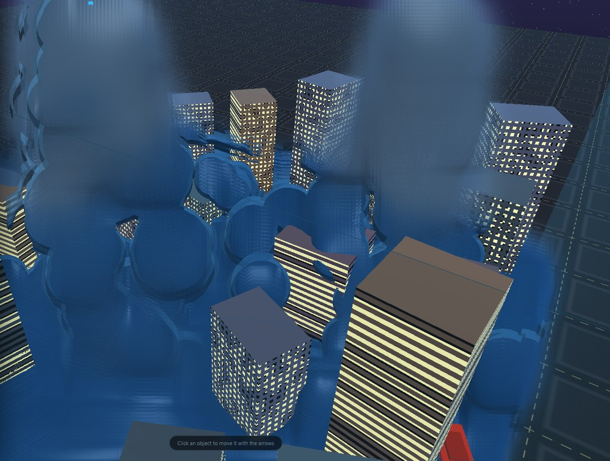

# FluidLab 3D

Симуляция жидкости в реальном времени в 3D прямо в браузере. Чистый **WebGL2** — без библиотек, без сборки, без CDN. Работает как с `file://`, так и с GitHub Pages.

**Живая демонстрация:** https://kotjleta.github.io/fluidlab-3d/

**English version:** [README.md](README.md)



---

## Что это

Решатель **Position Based Fluids (PBF)** целиком выполняется на GPU: пять фрагментных проходов на кадр (predict → плотность/λ → Δp → скорость), позиции и скорости хранятся в MRT-таргетах `RGBA32F`, поиск соседей — counting sort на CPU с загрузкой сетки в текстуру. Выделяется до 131 072 частиц, по умолчанию активны 24 576.

Жидкость рисуется как экранно-пространственная поверхность: частицы пишут глубину и толщину в float-таргеты, глубина проходит дилатацию и билатеральное размытие, толщина размывается отдельно, а композит добавляет френель, преломление, поглощение по Бэру–Ламберту и мягкий блик. В итоге масса читается как единое обтекаемое тело, а не как набор шаров.

Помимо жидкостей есть вторая категория — **сыпучие частицы** (снег, песок, пыль). Они не участвуют в PBF: падают под собственной гравитацией и сопротивлением, давления не имеют, и рисуются отдельными хлопьями и крупинками, а не поверхностью жидкости.

## Возможности

- **Жидкости:** вода, нефть, лава, слизь — у каждой свой шаг решётки, вязкость и плавучесть.
- **Сыпучие:** снег, песок, пыль — баллистические частицы со своей гравитацией и сопротивлением.
- **Уровни:** мини-город, средний город, гигантский город, снежный шар, остров с вулканом, портальная лаборатория.
- **Города по тайлам:** каждый город — сетка кварталов, одно здание на клетку, между ними дороги. Размер зданий, машин и частиц одинаков на всех трёх уровнях, отличается только число зданий (примерно 90 / 540 / 2350). Все здания рисуются одним draw call.
- **Сценарии по уровням:** потоп / прорыв канализации / цунами / ливень / смешение (города), снегопад (снежный шар), извержение / поток лавы / ливень (вулкан), портальная петля (портальная лаборатория). По умолчанию один источник; несколько — только там, где это часть сценария.
- **Остров с вулканом:** процедурный рельеф 34 × 34 — гребни, промоины и усечённый конус с чашей кратера, песчаная кромка и море вокруг. Лава течёт по радиальным расщелинам, на поверхности стоят ~150 пальм и камней.
- **Объёмные облака:** реймарчинг слоя облаков с fbm-плотностью и подсветкой солнцем; включаются во всех сценариях с ливнем, камера при этом опускается, чтобы небо попало в кадр.
- **Дождь:** сопло ливня размером во весь уровень — капли падают по всей площади, а не из одной трубы.
- **Режимы:** навигация («рука») и редактирование («курсор»); по умолчанию навигация.
- **Небо:** сетка, ночь, закат, день, туманность, студия, рождественская ночь.
- **Препятствия:** здания со светящимися окнами, машины, ёлки, снеговики, деревянные домики, конус вулкана — всё с коллизией.
- **Источники и объекты** добавляются, двигаются и редактируются; у каждого объекта есть инспектор.
- **Два языка:** английский и русский, при первом запуске выбирается по локали системы, переключаются в любой момент кнопками EN / RU в шапке панели.
- **Состояние сохраняется** в `localStorage`.

## Управление

| Ввод | Действие |
| --- | --- |
| ЛКМ + перетаскивание | Вращение камеры вокруг центра |
| WASD | Полёт |
| Space / Shift | Вверх / вниз |
| Q / E | Вверх / вниз (альтернатива) |
| Колесо | Зум |
| ПКМ + перетаскивание | Толкать жидкость |
| Клик (режим редактирования) | Выбрать объект |
| Стрелки (режим редактирования) | Двигать выбранный объект |

## Запуск

```bash
python -m http.server 8080
# затем открыть http://localhost:8080
```

В Windows `start.bat` открывает файл напрямую, `serve.bat` поднимает локальный сервер. Можно открыть и просто `index.html` с диска — ES-модулей и `fetch` в проекте нет.

## Структура

```
index.html        разметка и панели
css/style.css     оформление интерфейса
js/math.js        mat4 / vec3
js/gl.js          тонкие обёртки WebGL2
js/shaders.js     весь GLSL
js/sim.js         решатель PBF, сетка, эмиттеры
js/render.js      таргеты и проходы рендера
js/world.js       типы, уровни, сценарии, объекты
js/i18n.js        словари EN/RU
js/ui.js          построение панелей и подсказки
js/gizmo.js       гизмо перемещения объектов
js/store.js       сохранение в localStorage
js/main.js        цикл приложения, камера, ввод
```

## Требования

Браузер с WebGL2 и расширением `EXT_color_buffer_float` — все актуальные десктопные браузеры и большинство мобильных. Если расширения нет, приложение покажет понятное сообщение вместо пустого экрана.

## Лицензия

MIT.
